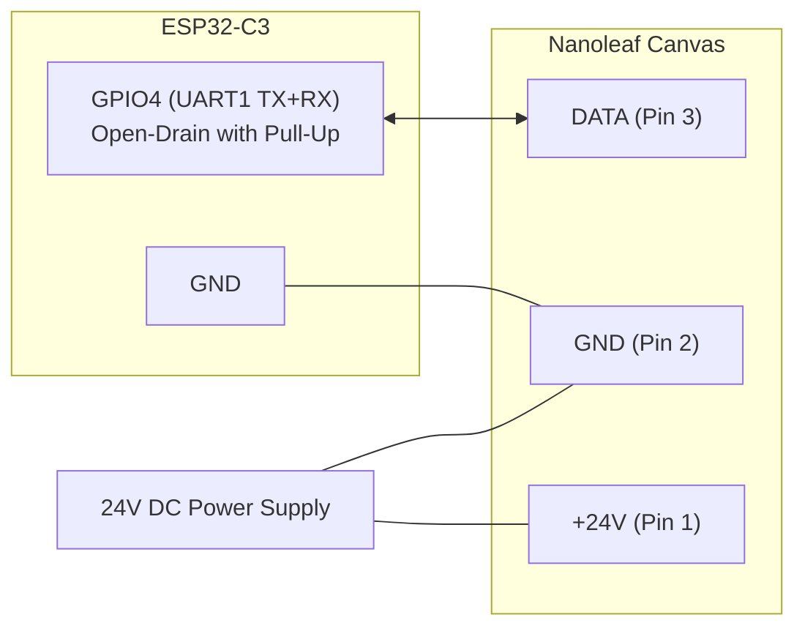

# Nanoleaf Canvas (NL29) Serial Bus Protocol Specification

This document specifies the low-level physical and data link protocol used by the **Nanoleaf Canvas (NL29)** light square system, reverse-engineered and verified using an **ESP32-C3** microcontroller.

---

## 1. Physical Layer

The Canvas interconnect system uses 3-pin edge linkers that carry DC power and bidirectional single-wire UART communication.

```
       +-------------------------------+
       |                               |
       |     Nanoleaf Canvas Tile      |
       |                               |
       +-[ 1 ]-------[ 2 ]-------[ 3 ]-+
          |             |           |
        +24V           GND        DATA (3.3V)
```

| Pin | Designation | Description | Electrical Characteristics |
|---|---|---|---|
| **1** | **+24V** | Main DC power rail | 24V DC from power supply (DO NOT connect directly to ESP32!) |
| **2** | **GND** | System Ground | Common reference ground shared between power supply, panels, and ESP32 |
| **3** | **DATA** | Bidirectional Data Line | 3.3V logic level, half-duplex single wire, weak onboard pull-up (~120 kΩ to 3.3V) |

### 1.1 ESP32-C3 Hardware Interface
Because the data line is a single half-duplex wire where both the controller and panels communicate, the transmitter **must release the line (Hi-Z)** when idle:

- **Bus Mode:** **Open-Drain** (`GPIO_MODE_INPUT_OUTPUT_OD`) with pull-up enabled.
- **Microcontroller Pin:** `GPIO4` (Header J3 Pin 11) routed to hardware `UART1`.
- **Common Ground:** `GND` (Header J3 Pin 12).
- **Line Parameters:** **1,000,000 baud (1 Mbaud), 8 data bits, no parity, 1 stop bit (8N1)**.



---

## 2. Packet Framing & Protocol Mechanics

- **Initiator:** The controller (ESP32) initiates all exchanges. Panels do not initiate packets unless polled.
- **Echo Handling:** On a single-wire bus, the receiver receives the echo of its own transmitted bytes. The controller driver must discard or strip the exact transmitted byte prefix from the receive buffer.
- **Integrity:** Packets use fixed or prefix-coded lengths without CRC/checksum for SET commands.

---

## 3. Command Reference

### 3.1 Root Side Detect (`0x00`)
- **Direction:** Controller → Panels (Broadcast)
- **Format:** `0x00` (1 byte)
- **Reply:** None
- **Purpose:** Tells the immediate panel which physical connector port is facing the controller ("root"). Must be sent prior to layout detection.

### 3.2 Layout Detection & Enumeration (`0x80`)
- **Direction:** Controller → Panels (Broadcast)
- **Format:** `0x80` (1 byte)
- **Reply:** Variable-length layout string, terminated by `0x40`.
- **Reply Format (1 Canvas panel with PSU attached):**
  ```text
  C0 93 00 00 40
  ```
  - `C0`: Panel Node
    - Bit 7: `1` (node marker)
    - Bits 6..4: `4` (4 edge connectors / square tile)
    - Bits 2..0: `0` (root connector index)
  - `93`: Power Supply Node
    - Bits 6..4: `1` (code 1 = PSU)
    - Bits 2..0: `3` (PSU connected to port 3)
  - `00 00`: Separators representing empty / unlinked connectors.
  - `0x40`: End-of-layout terminator.

### 3.3 Set Global Brightness (`0xFC 0x04`)
- **Direction:** Controller → Panels (Broadcast)
- **Format:** `FC 04 <brightness>` (3 bytes)
- **Parameters:**
  - `<brightness>`: `0x00` (Off) to `0xFF` (100% full brightness).
- **Reply:** None.

### 3.4 Set Global Color & Transition (`0xFC 0x06`)
- **Direction:** Controller → Panels (Broadcast)
- **Format:** `FC 06 <R> <G> <B> <W> <Transition>` (7 bytes)
- **Parameters:**
  - `<R>`: Red level (`0x00` - `0xFF`)
  - `<G>`: Green level (`0x00` - `0xFF`)
  - `<B>`: Blue level (`0x00` - `0xFF`)
  - `<W>`: Dedicated White level (`0x00` - `0xFF`)
  - `<Transition>`: Fade time in increments of ~100ms (e.g. `0x01` = immediate/fast fade, `0x0A` = 1s fade).
- **Reply:** None.

### 3.5 Touch Reporting Enable (`0xFC 0x07`)
- **Direction:** Controller → Panels (Broadcast)
- **Format:** `FC 07 <enable>` (3 bytes)
- **Parameters:**
  - `0x01`: Enable capacitive touch reporting.
  - `0x00`: Disable capacitive touch reporting.
- **Reply:** None.

### 3.6 Keep-Alive (`0xFC 0x08`)
- **Direction:** Controller → Panels (Broadcast)
- **Format:** `FC 08 00` (3 bytes)
- **Reply:** None.

### 3.7 Periodic Bulk Pull & Status (`0xC0`)
- **Direction:** Controller → Panels (Broadcast)
- **Format:** `0xC0` (1 byte)
- **Cadence:** Must be transmitted every **50 ms**. If polling stops for >2 seconds, panels may reset or ignore subsequent color commands.
- **Reply:** Exactly **`2 * N` bytes** (2 bytes per connected panel in depth-first layout order):
  - **Byte 1:** Status / Touch code:
    - `0x00`: Idle, no touch.
    - `0x10`: Release / idle baseline.
    - `0x11` - `0x17`: Touch gestures / active touch.
    - `0xCC`: **Hot-plug / topology changed** (indicates a panel was connected or disconnected; triggers immediate re-enumeration).
  - **Byte 2:** Reserved / gesture auxiliary data.

### 3.8 Individual Node Commands & Addressing (`0xF8`)
- **Direction:** Controller → Addressed Tile
- **Format:** `F8 <id_lo> <id_hi> <subcommand> [payload]`
- **Addressing:** `<id_lo> <id_hi>` is the zero-indexed 16-bit little-endian node ID assigned during tree enumeration (e.g. Node 0 is `00 00`, Node 1 is `01 00`, Node 2 is `02 00`).
- **Response Format:** The response is preceded by $K$ zeros (`0x00`), where $K$ is the hop count from the controller, followed by ACK `0x01` and the payload.

#### Subcommands:
- `0x81` (Get Firmware Version & Tile Type):
  - Request: `F8 <id> 00 81`
  - Response: `01 04 30 2E 31 2E 31 00 FF FF FF FF 34 2E 36 2E 30 ...`
  - Decoded: ACK `01`, Tile Type `04` (Canvas), Bootloader `"0.1.1\0"`, Firmware Version `"4.6.0\0"`.
- `0x82` (Get 18-Byte Hardware UID):
  - Request: `F8 <id> 00 82`
  - Response: `01 [18 bytes UID]`
- `0x06` (Set Individual Tile Color & Transition):
  - Request: `F8 <id_lo> <id_hi> 06 <R> <G> <B> <W> <Transition>` (8 bytes)
  - Reply: None (or leading hop acks)
  - Purpose: **Independently updates a single panel's color and transition time without changing other panels.** This enables arbitrary per-panel animations, color gradients, and chasing waves.

---

## 4. Multi-Panel Cluster Example & Layout Decoding

Real-world verified layout from a 12-panel + 1 PSU corner installation:

```text
Layout string (38 bytes):
C0 C0 00 00 C3 C0 C1 00 00 C0 00 00 00 00 C3 00 00 00 C1 00 C2 00 00 00 C0 C1 00 00 00 00 00 00 00 C2 00 93 00 40
```

- **Panel Nodes (`0xCn`):** 12 instances of `0xC0`, `0xC1`, `0xC2`, `0xC3` (`code = 4` -> 4-sided square Canvas tile). Low 2 bits indicate the physical connector facing the parent/root.
- **Power Supply Node (`0x93`):** `code = 1` -> PSU attached to connector port 3 of that branch.
- **Branch Separators (`0x00`):** Track the tree traversal and connector indexing.
- **Terminator (`0x40`):** Marks the completion of the layout string.
- **Bulk Pull (`0xC0`):** Yields exactly `24 bytes` ($12 \times 2$), with 2 status bytes per panel in depth-first layout order.

---

## 5. Minimal Startup Sequence

To initialize and control a Nanoleaf Canvas installation:

1. **Hardware Init:** Initialize UART1 on `GPIO4` at 1 Mbaud, 8N1 in Open-Drain mode with internal pull-up.
2. **Root Detect:** Send `0x00`. Wait 50 ms.
3. **Layout Detect:** Send `0x80`. Read until `0x40` (timeout up to 1000 ms for large clusters). Count node bytes (`0xCn`) to determine panel count $N$.
4. **Brightness:** Send `FC 04 FF` (set 100% brightness).
5. **Enable Touch:** Send `FC 07 01`.
6. **Set Initial Color:**
   - Global: `FC 06 R G B W T`
   - Individual: `F8 <id> 00 06 R G B W T` for each tile $0 \dots N-1$.
7. **Continuous Polling:** Schedule `0xC0` every 50 ms. If a reply contains `0xCC`, re-run steps 2–6.

---

## 6. ESPHome & Web Interface Architecture

The ESPHome integration is structured as an external component in `components/nanoleaf_canvas`:

### 6.1 Home Assistant Light Entity
- Platform: `nanoleaf_canvas`
- Implements `light::LightOutput` with RGB support.
- Full native integration for Home Assistant (power toggle, brightness 0–100%, and RGB color wheel).

### 6.2 Embedded Web Server & REST API (Port 80)
The ESP32 serves an interactive self-contained web app directly from flash:
- **`GET /` or `/canvas`**: Interactive dark-mode web application featuring real-time SVG 2D layout mapping, tile selection, and color picking.
- **`GET /api/tiles`**: Returns current JSON array of all discovered tiles with their Cartesian $(X, Y)$ grid positions, orientation, and current RGB colors.
- **`GET /api/set?id=<id>&r=<r>&g=<g>&b=<b>`**: Independently sets an individual tile's color using `F8 <id> 00 06 ...`.
- **`GET /api/all?r=<r>&g=<g>&b=<b>[&bri=<0-255>]`**: Broadcasts global color (`FC 06`) and/or brightness (`FC 04`) to all tiles.
- **`GET /api/effect?name=<wave|static_rainbow|off>`**: Activates built-in dynamic lighting effects (e.g. real-time flowing rainbow wave).

