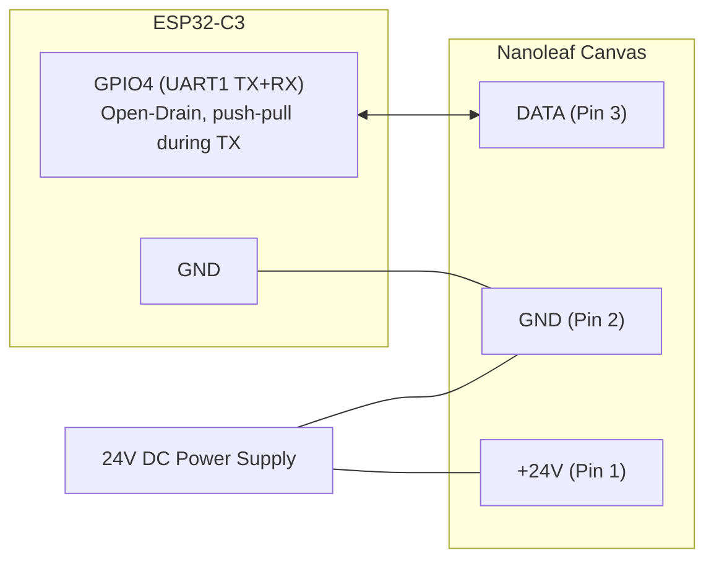

# Nanoleaf Canvas (NL29) Serial Bus Protocol Specification

This document specifies the low-level physical and data link protocol used by the **Nanoleaf Canvas (NL29)** light square system, reverse-engineered and verified using an **ESP32-C3** microcontroller.

---

## 1. Physical Layer

The Canvas interconnect system uses 3-pin edge linkers that carry DC power and bidirectional single-wire UART communication.

```
       +-------------------------------+
       |                               |
       |     Nanoleaf Canvas Tile      |
       |                               |
       +-[ 1 ]-------[ 2 ]-------[ 3 ]-+
          |             |           |
        +24V           GND        DATA (3.3V)
```

| Pin | Designation | Description | Electrical Characteristics |
|---|---|---|---|
| **1** | **+24V** | Main DC power rail | 24V DC from power supply (DO NOT connect directly to ESP32!) |
| **2** | **GND** | System Ground | Common reference ground shared between power supply, panels, and ESP32 |
| **3** | **DATA** | Bidirectional Data Line | 3.3V logic level, half-duplex single wire, weak onboard pull-up (~120 kΩ to 3.3V) |

### 1.1 ESP32-C3 Hardware Interface
Because the data line is a single half-duplex wire where both the controller and panels communicate, the transmitter **must release the line (Hi-Z)** when idle:

- **Bus Mode:** **Open-Drain** (`GPIO_MODE_INPUT_OUTPUT_OD`) with pull-up enabled, switched to **push-pull while transmitting** frames that have no reply.
- **Edge speed matters:** with only the internal ~45 kΩ pull-up, rising edges are too slow at 1 Mbaud and panels misread about 20% of frames (measured: 129/160 `F8 … 81` requests answered open-drain vs. 160/160 push-pull). Symptoms: a brightness or color change reaches only some panels. Do not stay push-pull while a reply is expected: the panels answer a `C0` poll almost immediately, and driving the line then corrupts the first reply byte. An external 1–2.2 kΩ pull-up to 3.3 V is recommended.
- **Microcontroller Pin:** `GPIO4` (Header J3 Pin 11) routed to hardware `UART1`.
- **Common Ground:** `GND` (Header J3 Pin 12).
- **Line Parameters:** **1,000,000 baud (1 Mbaud), 8 data bits, no parity, 1 stop bit (8N1)**.



---

## 2. Packet Framing & Protocol Mechanics

- **Initiator:** The controller (ESP32) initiates all exchanges. Panels do not initiate packets unless polled.
- **Echo Handling:** On a single-wire bus, the receiver receives the echo of its own transmitted bytes. The controller driver must discard or strip the exact transmitted byte prefix from the receive buffer.
- **Integrity:** Packets use fixed or prefix-coded lengths without CRC/checksum for SET commands.
- **One frame per write:** panels relay frames hop by hop and drop a frame that follows the previous one with no idle gap. Several frames concatenated in one write reach only the first panel. Send each frame on its own (waiting for its echo is enough; ~100 µs gap used).
- **Keep polling:** with `C0` polls paused for a few seconds, the panels drop their enumeration and stop answering until `00` + `80` is sent again.

---

## 3. Command Reference

### 3.1 Root Side Detect (`0x00`)
- **Direction:** Controller → Panels (Broadcast)
- **Format:** `0x00` (1 byte)
- **Reply:** None
- **Purpose:** Tells the immediate panel which physical connector port is facing the controller ("root"). Must be sent prior to layout detection.

### 3.2 Layout Detection & Enumeration (`0x80`)
- **Direction:** Controller → Panels (Broadcast)
- **Format:** `0x80` (1 byte)
- **Reply:** Variable-length layout string, terminated by `0x40`.
- **Reply Format (1 Canvas panel with PSU attached):**
  ```text
  C0 93 00 00 40
  ```
  - `C0`: Panel Node
    - Bit 7: `1` (node marker)
    - Bits 6..4: `4` (4 edge connectors / square tile)
    - Bits 2..0: `0` (root connector index)
  - `93`: Power Supply Node
    - Bits 6..4: `1` (code 1 = PSU)
    - Bits 2..0: `3` (PSU connected to port 3)
  - `00 00`: Separators representing empty / unlinked connectors.
  - `0x40`: End-of-layout terminator.
- **Reliability:** reads are sometimes truncated or corrupted (e.g. ending in `FF` without a terminator). Read the string at least twice and accept one that repeats, as in the Shapes spec (`PROTOCOL.md` §9.2). The 38-byte string of the 12-panel assembly arrives in ~4 ms.

### 3.3 Set Global Brightness (`0xFC 0x04`)
- **Direction:** Controller → Panels (Broadcast)
- **Format:** `FC 04 <brightness>` (3 bytes)
- **Parameters:**
  - `<brightness>`: `0x00` (Off) to `0xFF` (100% full brightness).
- **Reply:** None.
- **Per panel:** `F8 <id_lo> <id_hi> 04 <brightness>` sets one panel's brightness.
- **Curve:** the output looks roughly linear in the value (`0x04` barely visible in a lit room, `0x10` clearly visible), so the firmware applies the light's gamma (`gamma_correct`, ESPHome default 2.8) to brightness.

### 3.4 Set Global Color & Transition (`0xFC 0x06`)
- **Direction:** Controller → Panels (Broadcast)
- **Format:** `FC 06 <R> <G> <B> <W> <Transition>` (7 bytes)
- **Parameters:**
  - `<R>`: Red level (`0x00` - `0xFF`)
  - `<G>`: Green level (`0x00` - `0xFF`)
  - `<B>`: Blue level (`0x00` - `0xFF`)
  - `<W>`: Dedicated White level (`0x00` - `0xFF`)
  - `<Transition>`: Fade time, presumably in ~100 ms steps (unverified). The firmware sends `0x01` and lets ESPHome drive longer transitions.
- **Reply:** None.
- **Notes:** Unlike Shapes, Canvas panels act on `FC 06` and `F8 <id> 06`; the Shapes bulk push `E0 03 …` has **no effect** on Canvas. A frame with `W ≠ 0` is ignored entirely, so always send `W = 0`.

### 3.5 Touch Reporting Enable (`0xFC 0x07`)
- **Direction:** Controller → Panels (Broadcast)
- **Format:** `FC 07 <enable>` (3 bytes)
- **Parameters:**
  - `0x01`: Enable capacitive touch reporting.
  - `0x00`: Disable capacitive touch reporting.
- **Reply:** None.

### 3.6 Keep-Alive (`0xFC 0x08`)
- **Direction:** Controller → Panels (Broadcast)
- **Format:** `FC 08 00` (3 bytes)
- **Reply:** None.

### 3.7 Periodic Bulk Pull & Status (`0xC0`)
- **Direction:** Controller → Panels (Broadcast)
- **Format:** `0xC0` (1 byte)
- **Cadence:** Must be transmitted every **50 ms**. When polling paused for a few seconds, the panels dropped their enumeration and stopped answering polls until `00` + `80` was sent again.
- **Timing:** the 24-byte reply of 12 panels is complete ~2 ms after the poll. The first reply byte follows the poll almost immediately, so the line must already be released (open drain) when the poll's stop bit ends.
- **Reply:** Exactly **`2 * N` bytes** (2 bytes per connected panel in depth-first layout order):
  - **Byte 1:** Status / Touch code:
    - `0x00`: Idle, no touch.
    - `0x10`: Release / idle baseline.
    - `0x11` - `0x17`: Touch gestures / active touch.
    - `0xCC`: **Hot-plug / topology changed** (indicates a panel was connected or disconnected; triggers immediate re-enumeration). The whole reply is then a lone `CC`, and it stays that way: **panels ignore color and brightness frames until `00` + `80` is sent again**. On the test setup it also appeared spontaneously several times a minute, so re-enumerate promptly (the firmware waits at most 250 ms) and resend the state.
  - **Byte 2:** Reserved / gesture auxiliary data.

### 3.8 Individual Node Commands & Addressing (`0xF8`)
- **Direction:** Controller → Addressed Tile
- **Format:** `F8 <id_lo> <id_hi> <subcommand> [payload]`
- **Addressing:** `<id_lo> <id_hi>` is the zero-indexed 16-bit little-endian node ID. On the 12-panel test assembly the ids were verified (by lighting each one) to equal the panels' depth-first positions in the layout string. An id byte ≥ `0x80` is misread as a frame type (e.g. `F8 C0 …` triggers a poll reply), so the low byte must stay below `0x80`.
- **Response Format:** The response is preceded by $K$ zeros (`0x00`), where $K$ is usually the hop count from the controller, followed by ACK `0x01` and the payload. The zero count is not reliable (id 10, five hops deep, answered with two zeros), so do not use it to derive the topology.

#### Subcommands:
- `0x81` (Get Firmware Version & Tile Type):
  - Request: `F8 <id> 00 81`
  - Response: `01 04 30 2E 31 2E 31 00 FF FF FF FF 34 2E 36 2E 30 ...`
  - Decoded: ACK `01`, Tile Type `04` (Canvas), Bootloader `"0.1.1\0"`, Firmware Version `"4.6.0\0"`.
- `0x82` (Get 18-Byte Hardware UID):
  - Request: `F8 <id> 00 82`
  - Response: `01 [18 bytes UID]`
- `0x06` (Set Individual Tile Color & Transition):
  - Request: `F8 <id_lo> <id_hi> 06 <R> <G> <B> <W> <Transition>` (8 bytes)
  - Reply: None (or leading hop acks)
  - Purpose: **Independently updates a single panel's color and transition time without changing other panels.** This enables arbitrary per-panel animations, color gradients, and chasing waves. `W` must be `0` (see 3.4). Send each panel's frame as a separate write (section 2).
- `0x04` (Set Individual Tile Brightness):
  - Request: `F8 <id_lo> <id_hi> 04 <brightness>` (5 bytes)
  - Reply: None.

---

## 4. Multi-Panel Cluster Example & Layout Decoding

Real-world verified layout from a 12-panel + 1 PSU corner installation:

```text
Layout string (38 bytes):
C0 C0 00 00 C3 C0 C1 00 00 C0 00 00 00 00 C3 00 00 00 C1 00 C2 00 00 00 C0 C1 00 00 00 00 00 00 00 C2 00 93 00 40
```

- **Panel Nodes (`0xCn`):** 12 instances of `0xC0`, `0xC1`, `0xC2`, `0xC3` (`code = 4` -> 4-sided square Canvas tile). Low 2 bits indicate the physical connector facing the parent/root.
- **Power Supply Node (`0x93`):** `code = 1` -> PSU attached to connector port 3 of that branch.
- **Branch Separators (`0x00`):** Track the tree traversal and connector indexing.
- **Terminator (`0x40`):** Marks the completion of the layout string.
- **Bulk Pull (`0xC0`):** Yields exactly `24 bytes` ($12 \times 2$), with 2 status bytes per panel in depth-first layout order.

---

## 5. Minimal Startup Sequence

To initialize and control a Nanoleaf Canvas installation:

1. **Hardware Init:** Initialize UART1 on `GPIO4` at 1 Mbaud, 8N1 in Open-Drain mode with pull-up; drive push-pull while sending frames that have no reply (section 1.1).
2. **Root Detect:** Send `0x00`. Wait ~30 ms.
3. **Layout Detect:** Send `0x80`. Read until `0x40` (timeout up to 1000 ms for large clusters). Repeat steps 2–3 until two reads match. Count node bytes (`0xCn`) to determine panel count $N$.
4. **Brightness:** Send `FC 04 <brightness>`.
5. **Enable Touch:** Send `FC 07 01`.
6. **Set Initial Color:**
   - Global: `FC 06 R G B 00 T`
   - Individual: `F8 <id> 00 06 R G B 00 T` for each tile $0 \dots N-1$, one frame per write.
7. **Continuous Polling:** Schedule `0xC0` every 50 ms. If a reply contains `0xCC`, re-run steps 2–6 right away.

---

## 6. ESPHome & Web Interface Architecture

The ESPHome integration is structured as an external component in `components/nanoleaf_canvas`:

### 6.1 Home Assistant Light Entity
- Platform: `nanoleaf_canvas`
- Implements `light::LightOutput` with RGB support.
- Full native integration for Home Assistant (power toggle, brightness 0–100%, RGB color wheel, transitions).
- Brightness is sent once, through `FC 04` (gamma-corrected); colors are sent at full scale, so dimming does not quantize or shift colors.
- A color change repaints all tiles; a brightness-only change keeps per-tile colors.
- Effects registered on the light: **Rainbow Wave** (hue follows tile position, 50 ms steps) and **Static Rainbow**.

### 6.2 Embedded Web Server & REST API (Port 80)
The ESP32 serves an interactive self-contained web app directly from flash:
- **`GET /` or `/canvas`**: Interactive dark-mode web application featuring real-time SVG 2D layout mapping, tile selection, and color picking.
- **`GET /api/tiles`**: Returns current JSON array of all discovered tiles with their Cartesian $(X, Y)$ grid positions, orientation, and current RGB colors.
- **`GET /api/set?id=<id>&r=<r>&g=<g>&b=<b>`**: Independently sets an individual tile's color using `F8 <id> 00 06 ...`.
- **`GET /api/debug`**, **`/api/raw?hex=<frames>`**, **`/api/buscfg`**: diagnostics, raw frame experiments (frames separated by `-`), and runtime bus settings.
- **`GET /api/all?r=<r>&g=<g>&b=<b>[&bri=<0-255>]`**: Sets the light's color and/or brightness through the ESPHome light, so Home Assistant stays in sync.
- **`GET /api/effect?name=<wave|static_rainbow|none|off>`**: Starts the "Rainbow Wave" / "Static Rainbow" light effects, stops them (`none`), or turns the light off.

### 6.3 Threading
The ESP-IDF web server runs in its own FreeRTOS task. Web requests are queued and executed on the ESPHome main loop, which is the only code that touches the UART, so web and Home Assistant traffic can no longer interleave on the bus.

